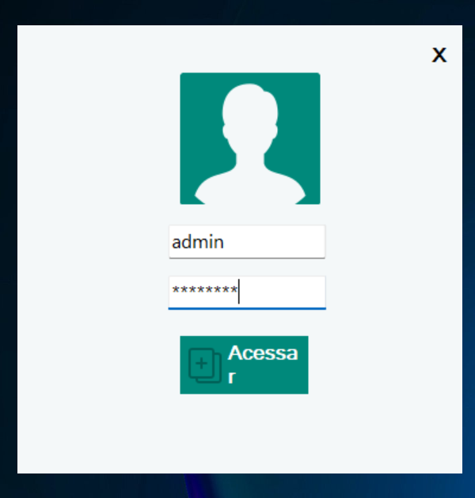
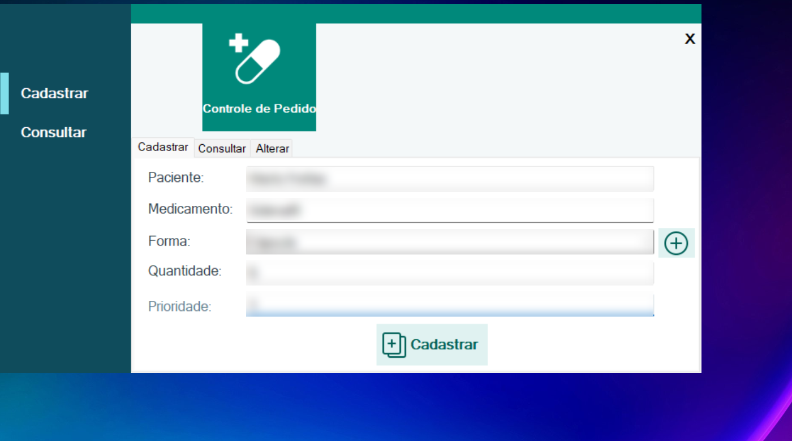
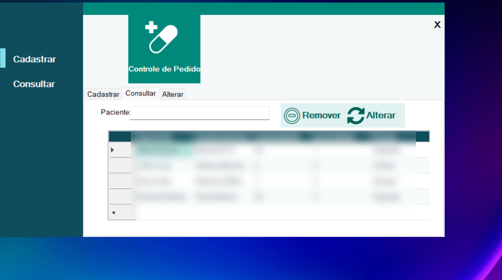
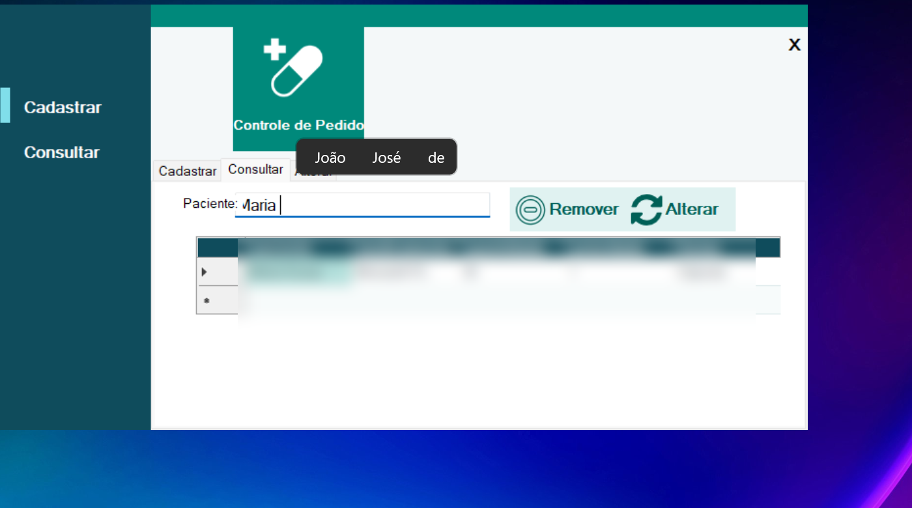

# Controle de Pedidos

Aplicação desktop desenvolvida em C# com Windows Forms para gerenciamento de pedidos, incluindo cadastro, consulta, alteração e remoção de registros.

## Funcionalidades

- **Login:** acesso ao sistema.
- **Cadastro de pedidos:** registro de novos pedidos.
- **Consulta:** visualização dos pedidos cadastrados.
- **Alteração:** edição de informações dos pedidos.
- **Remoção:** exclusão de registros.

## Interface do Sistema

### Login

Tela de acesso à aplicação.

### Cadastro de Pedidos

Interface para inserir informações e cadastrar novos pedidos.

### Consulta de Pedidos

Tela destinada à consulta e visualização dos pedidos registrados.

### Alteração de Pedidos

Interface para editar informações de pedidos existentes.

## Ferramentas e Tecnologias

- **C#** — linguagem de programação utilizada no desenvolvimento.
- **Windows Forms** — criação da interface gráfica.
- **SQL** — linguagem utilizada para manipulação de dados.
- **MySQL** — sistema de gerenciamento do banco de dados.
- **MySQL Workbench** — ferramenta para gerenciamento e modelagem do banco de dados.
- **Visual Studio** — ambiente de desenvolvimento (IDE).
